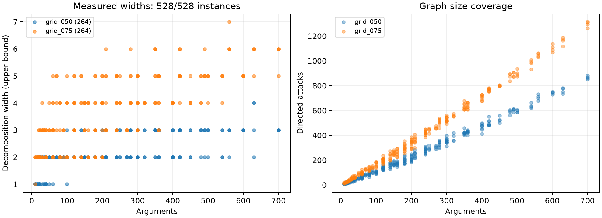

# PAF grid benchmark for grounded extension verification

This provisional collection contains probabilistic argumentation frameworks
(PAFs) generated from shuffled grids and reference results for probabilistic
extension verification under grounded semantics.

It is an audited import of existing research artifacts. It is not the KR 2024
PAF-TD collection: the latter uses a related generator lineage but will be
curated independently.

## Contents

```text
paf-grid-grounded-pext/
├── README.md
├── index.tsv
└── instances/
    ├── grid_050/
    └── grid_075/
```

The `.lp` files are the authoritative instances. `index.tsv` contains one row
per instance, including reference-result status, labels when available,
structural metadata, provenance, and the instance SHA-256 digest. No machine-
learning train, validation, or test split is prescribed.

## Task

For a PAF `P` and the candidate set `S` encoded by its `extension(...)` facts,
the task is to compute the probability that `S` is exactly the grounded
extension of a possible world of `P` under the constellation approach.

Each file also contains one `in(...)` fact. That fact identifies the query
argument used by the separate probabilistic-acceptance experiments; it is not
part of the extension-verification input and was ignored when producing these
labels.

The main predicates are:

- `arg(a).` declares argument `a`;
- `att(a,b).` declares an attack from `a` to `b`;
- `p(a,0.8).` gives the probability that argument `a` exists;
- `p(i,a,b,0.7).` gives the probability of the attack identified by `i`;
- `extension(a).` puts `a` in the candidate set; and
- `in(a).` records the separate acceptance-query argument.

## Generator construction

Both families use a shuffled `n`-by-`k` grid. The filename records the grid
parameters and replicate, for example `k3_n20_qa24_4.lp`. The total number of
arguments is `k * n`; `qa24` records query argument `a24`.

The parameter `k` controls generation and is not a measured treewidth.
`families.tsv` records the historical settings curated from the source
generator code. The historical seeds are unavailable and remain unrecorded.

<!-- probarg-report:start -->
## Families and generator parameters

| Family | Grid-edge probability | k | n | Replicates | Instances | Master seed |
| --- | --- | --- | --- | --- | --- | --- |
| grid_050 | 50% | 2, 3, 4, 5, 6, 7 | 5, 10, 20, 30, 40, 50, 60, 70, 80, 90, 100 | 4 | 264 | unrecorded |
| grid_075 | 75% | 2, 3, 4, 5, 6, 7 | 5, 10, 20, 30, 40, 50, 60, 70, 80, 90, 100 | 4 | 264 | unrecorded |

- `grid_050`: generator `legacy-journal-grid`; candidate inclusion probability 0.04; sampling weight of probability one 0.1 (each value 0.1–0.9 has weight 10).
- `grid_075`: generator `legacy-journal-grid`; candidate inclusion probability 0.04; sampling weight of probability one 0.1 (each value 0.1–0.9 has weight 10).

Seeds marked unrecorded are unavailable for historical instances.

## Structural coverage

| Family | Instances | Analyzed | Arguments | Directed attacks | Weak components | Decomposition width | Valid widths | Other statuses |
| --- | --- | --- | --- | --- | --- | --- | --- | --- |
| grid_050 | 264 | 264 | 10–700 | 6–880 | 1–119 | 1–4 | 264 | none |
| grid_075 | 264 | 264 | 10–700 | 11–1314 | 1–19 | 1–7 | 264 | none |

Graph: the underlying undirected graph of declared attacks, with reciprocal attacks collapsed and self-attacks omitted for width computation.
Widths are validated decomposition upper bounds on treewidth. Ranges describe the analyzed rows; instances outside a partial analysis have no measurements in this report.



Sources: [family parameters](families.tsv), [per-instance measurements](analysis/htd-v1/index.tsv), [measurement configuration](analysis/htd-v1/run.json).
<!-- probarg-report:end -->

The original imported index and probability labels remain the record of their
earlier solver runs; a successful fresh width measurement does not recompute
a previously failed probability label.

## Reference results

The labels come from the exact tree-decomposition solver `ver-td-GRD` in the
source experiment repository. The import retains unsuccessful statuses instead
of silently dropping their instances.

| Family | Instances | Results | Timeouts | Invalid decompositions |
| --- | ---: | ---: | ---: | ---: |
| `grid_050` | 264 | 263 | 0 | 1 |
| `grid_075` | 264 | 185 | 74 | 5 |
| **Total** | **528** | **448** | **74** | **6** |

Of the 448 usable results, 52 were emitted as exact `Fraction(numerator,
denominator)` values. Their reduced numerator and denominator are preserved in
the index. The other 396 were serialized by the solver as decimals; the index
preserves those strings but does not claim that the serialization itself is an
exact rational representation. `label_decimal` gives a convenient model target
for both representations.

## Index columns

- identity and provenance: `instance_id`, `instance_path`, `family`,
  `instance_sha256`, `source_commit`;
- generator metadata: `generator_k`, `generator_n`, `replicate`;
- graph and query metadata: `argument_count`, `attack_count`,
  `candidate_size`, `query_argument`, `semantics`, `task`;
- result metadata: `label_status`, `label_decimal`, `label_numerator`,
  `label_denominator`, `source_representation`, `solver`; and
- decomposition metadata: `largest_bag_size`, `decomposition_width`.

Only rows with `label_status = result` have usable labels.

## Provenance and audit

The instances and solver outputs originate from
[`paf-ver-acc-journal-experiments`](https://gitlab.tugraz.at/krr/paf-ver-acc-journal-experiments)
at commit `699275f093cc4c68c688d93c8f3ac10635be3a30`.

The compiled source-result files used during the import had these SHA-256
digests:

- `journal_set_050`: `bd351e8f415231ea23112c638e19730af7fe5fd8356a08fac1f0f64ae472c830`;
- `journal_set_075`: `e70fb9c7eb7f39d68758a9740512c66f165ec7f8843c58694a916c1627205b4a`.

The import audit checked all 528 files for declared arguments, attacks,
probabilities, candidate membership, query membership, probability bounds,
filename parameters, result association, and duplicate arguments or attacks.
It also compared every usable label and instance hash with the 448-row rebuilt manifest in
[`llm-prob-arg-approx`](https://github.com/andreipopi/llm-prob-arg-approx) at
commit `78110af0a5122e528bf3fca71e0bb59dedf683d9`.

The fine-tuning repository's rendered prompts and its train/validation/test
splits are deliberately not included here. They are downstream ML choices, not
properties of this benchmark collection.

## Known limitations before a stable release

- The historical generator used unseeded randomness, so these exact instances
  cannot currently be regenerated from a recorded seed.
- The two density configurations were produced by editing hard-coded generator
  settings rather than by a stable command-line parameter.
- Decimal-only solver outputs should be re-exported from the exact internal
  representation where possible.
- Dataset and code licenses still need to be stated before publication.

For these reasons this directory should be treated as a useful, integrity-
checked starting point rather than the final versioned release.
