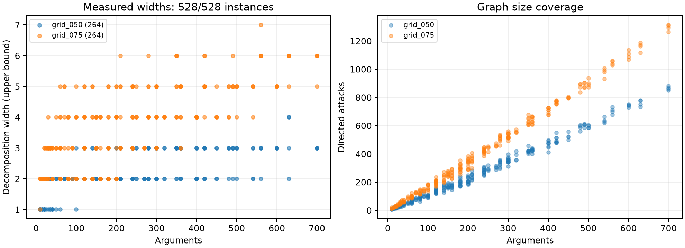

# Dataset report

## Families and generator parameters

| Family | Grid-edge probability | k | n | Replicates | Instances | Master seed |
| --- | --- | --- | --- | --- | --- | --- |
| grid_050 | 50% | 2, 3, 4, 5, 6, 7 | 5, 10, 20, 30, 40, 50, 60, 70, 80, 90, 100 | 4 | 264 | unrecorded |
| grid_075 | 75% | 2, 3, 4, 5, 6, 7 | 5, 10, 20, 30, 40, 50, 60, 70, 80, 90, 100 | 4 | 264 | unrecorded |

- `grid_050`: generator `legacy-journal-grid`; candidate inclusion probability 0.04; sampling weight of probability one 0.1 (each value 0.1–0.9 has weight 10).
- `grid_075`: generator `legacy-journal-grid`; candidate inclusion probability 0.04; sampling weight of probability one 0.1 (each value 0.1–0.9 has weight 10).

Seeds marked unrecorded are unavailable for historical instances.

## Structural coverage

| Family | Instances | Analyzed | Arguments | Directed attacks | Weak components | Decomposition width | Valid widths | Other statuses |
| --- | --- | --- | --- | --- | --- | --- | --- | --- |
| grid_050 | 264 | 264 | 10–700 | 6–880 | 1–119 | 1–4 | 264 | none |
| grid_075 | 264 | 264 | 10–700 | 11–1314 | 1–19 | 1–7 | 264 | none |

Graph: the underlying undirected graph of declared attacks, with reciprocal attacks collapsed and self-attacks omitted for width computation.
Widths are validated decomposition upper bounds on treewidth. Ranges describe the analyzed rows; instances outside a partial analysis have no measurements in this report.

Sources: [family parameters](../../families_parameters.tsv), [per-instance measurements](analysis_instances.tsv), [measurement configuration](analysis_settings.json).
