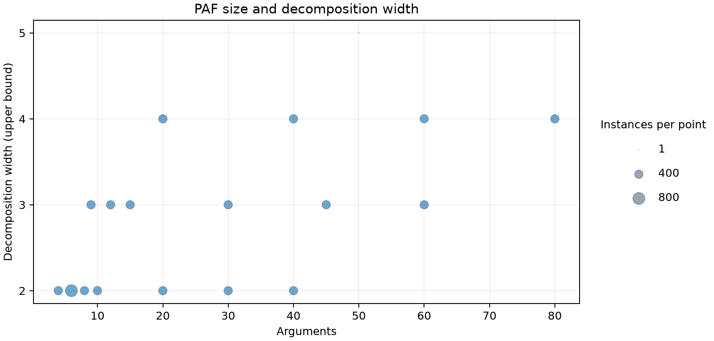

# paf-pw24-main-v1

12,000 PAFs with 4–120 arguments, generated by a full-grid variant of the KR 2024 generator.
Every neighbouring grid pair has a forward, reverse or bidirectional attack,
chosen with equal probability. Argument and attack probabilities retain the original settings.
The runner records seeds and settings. The instances can be used with different
semantics; each set of labels specifies its task and semantics.

## Source paper and code

Andrei Popescu and Johannes P. Wallner. *Advancing Algorithmic Approaches to Probabilistic Argumentation under the Constellation Approach*. KR 2024.
[Published paper](https://doi.org/10.24963/kr.2024/55).

Source: `https://gitlab.tugraz.at/krr/paf-td`, commit `df7961a39dc666610298d7d2539ee2a8da315508`,
`InstanceGenerator/praaf_grid_generator_dense.py`. Its SHA-256 is `54e38b700c2409f193f3c94cb2a798fe6ccfdcf27a7e73eeedcdd7404efa5a38`.

## Files

`instances/` contains the original native files with generation settings
prepended as `%` comments. Their names, facts and ordering are preserved.
`extension(...)` specifies the candidate set and `query(...)` the separate query argument.
`instances_asp/` contains the same instances with probabilities scaled to integers out of 10000.
These are alternate solver inputs, not additional benchmark examples.

`generation_settings.json` saves the settings; `families_parameters.tsv` lists the family parameters.

<!-- probarg-report:start -->
## Generator parameters

| k | n | Replicates | Grid connection probability |
| --- | --- | --- | --- |
| 2, 3, 4, 5, 6 | 2, 3, 5, 10, 15, 20 | 400 | 100% |

`k` and `n` are grid dimensions, so each PAF has `k × n` arguments. Replicates are separately generated instances for each `(k, n)` pair.
A grid connection means at least one attack between neighbouring vertices.

## Dataset summary

| Instances | Arguments | Attacks | Candidate size | Width upper bound |
| --- | --- | --- | --- | --- |
| 12000 | 4–120 | 4–303 | 0–11 | 2–5 |

Attacks are directed. Widths are validated upper bounds on treewidth of the undirected attack graph.

Analysed 12000/12000 instances; valid widths: 7202/12000.
Ranges cover analysed instances; widths cover successful decompositions.

- grid_100: not_run=4798.

Empty candidate sets: 4486/12000 (37.4%).

Circle area represents the number of instances at each size and width.

Details: [generator settings](families_parameters.tsv) · [measurements](analysis/solver-td-v1/analysis_instances.tsv) · [analysis settings](analysis/solver-td-v1/analysis_settings.json).
<!-- probarg-report:end -->

## Labels

[`labels/complete-extension-td-v1/labels_results.tsv`](labels/complete-extension-td-v1/labels_results.tsv)
contains exact complete-extension probabilities under the constellation model
for 7,202 instances. The other 4,798 rows have status `not_run`. Solver
provenance and limits are in
[`labels_settings.json`](labels/complete-extension-td-v1/labels_settings.json).
The labelled rows cover all 400 replicates for `k = 2, 3, 4` at every listed
`n`, plus two instances with `k = 5, n = 10`.

Structural statistics for all 12,000 instances and validated decomposition
widths for the 7,202 solved instances are under [`analysis/solver-td-v1/`](analysis/solver-td-v1/).

## License and citation

Dataset instances, labels and measurements are available under the
[Creative Commons Attribution 4.0 International License](../../LICENSE-DATA).
Repository code is available under the [MIT License](../../LICENSE); the
original generator notice is retained in `generators/LICENSE-PW24-source`.
Cite the source paper above.
