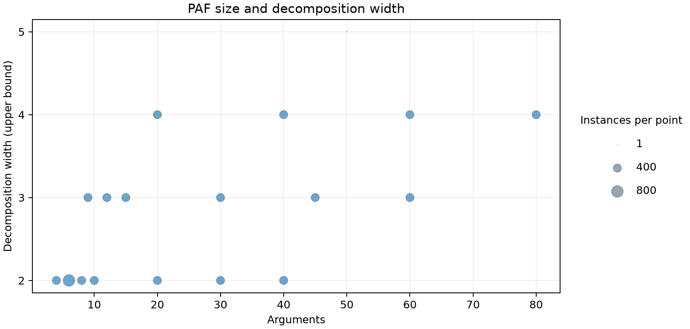

# Dataset report

## Generator parameters

| k | n | Replicates | Grid connection probability |
| --- | --- | --- | --- |
| 2, 3, 4, 5, 6 | 2, 3, 5, 10, 15, 20 | 400 | 100% |

`k` and `n` are grid dimensions, so each PAF has `k × n` arguments. Replicates are separately generated instances for each `(k, n)` pair.
A grid connection means at least one attack between neighbouring vertices.

## Dataset summary

| Instances | Arguments | Attacks | Candidate size | Width upper bound |
| --- | --- | --- | --- | --- |
| 12000 | 4–120 | 4–303 | 0–11 | 2–5 |

Attacks are directed. Widths are validated upper bounds on treewidth of the undirected attack graph.

Analysed 12000/12000 instances; valid widths: 7202/12000.
Ranges cover analysed instances; widths cover successful decompositions.

- grid_100: not_run=4798.

Empty candidate sets: 4486/12000 (37.4%).

Circle area represents the number of instances at each size and width.

Details: [generator settings](../../families_parameters.tsv) · [measurements](analysis_instances.tsv) · [analysis settings](analysis_settings.json).
