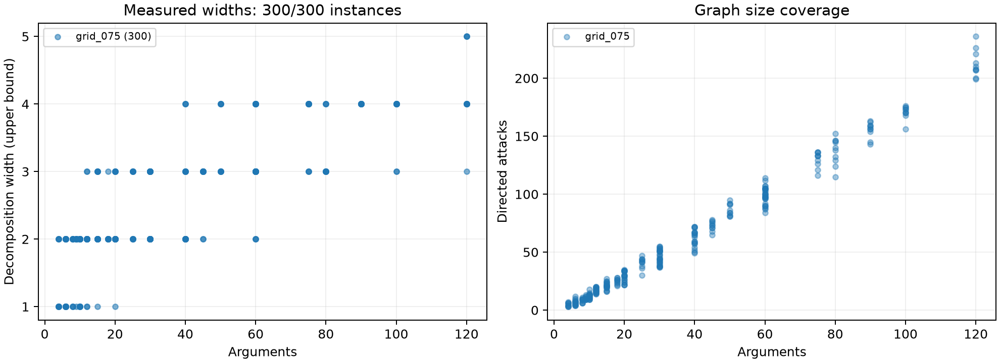

# paf-pw24-pilot-v1

300 PAFs with 4–120 arguments, generated with recorded seeds using the
original KR 2024 dense-grid generator. Complete-extension labels are pending.

> Andrei Popescu and Johannes P. Wallner. *Advancing Algorithmic Approaches to
> Probabilistic Argumentation under the Constellation Approach*. KR 2024.
> [Published paper](https://doi.org/10.24963/kr.2024/55).

## Files and format

`instances/` contains decimal-probability PAFs; `instances_asp/` contains the
same PAFs scaled to integers out of 10000. `extension(...)` is the candidate
set; `query(...)` is the separate acceptance query. Generation information is
prepended as `% probarg ...` comments.

[Generation settings](generation_settings.json) record the command, source
versions and hashes. [Per-instance records](generation_instances.tsv) contain
seeds and file hashes. See the [workflow](../../README.md#generating-and-measuring-a-paf-dataset)
for the commands and the [measured summary](analysis/htd-v1/analysis_summary.md)
for graph statistics and decomposition widths.

<!-- probarg-report:start -->
## Families and generator parameters

| Family | Grid-edge probability | k | n | Replicates | Instances | Master seed |
| --- | --- | --- | --- | --- | --- | --- |
| grid_075 | 75% | 2, 3, 4, 5, 6 | 2, 3, 5, 10, 15, 20 | 10 | 300 | 20261105 |

- `grid_075`: generator `PW24-original-dense-v1`; candidate inclusion probability 0.04; sampling weight of probability one 0.1 (each value 0.1–0.9 has weight 10).

## Structural coverage

| Family | Instances | Analyzed | Arguments | Directed attacks | Weak components | Decomposition width | Valid widths | Other statuses |
| --- | --- | --- | --- | --- | --- | --- | --- | --- |
| grid_075 | 300 | 300 | 4–120 | 3–236 | 1–7 | 1–5 | 300 | none |

Graph: the underlying undirected graph of declared attacks, with reciprocal attacks collapsed and self-attacks omitted for width computation.
Widths are validated decomposition upper bounds on treewidth. Ranges describe the analyzed rows; instances outside a partial analysis have no measurements in this report.

Sources: [family parameters](families_parameters.tsv), [per-instance measurements](analysis/htd-v1/analysis_instances.tsv), [measurement configuration](analysis/htd-v1/analysis_settings.json).
<!-- probarg-report:end -->

## License

The original code's MIT notice is retained in `generators/LICENSE-PW24-source`
in ProbArgBench. The dataset license remains to be stated before publication.
