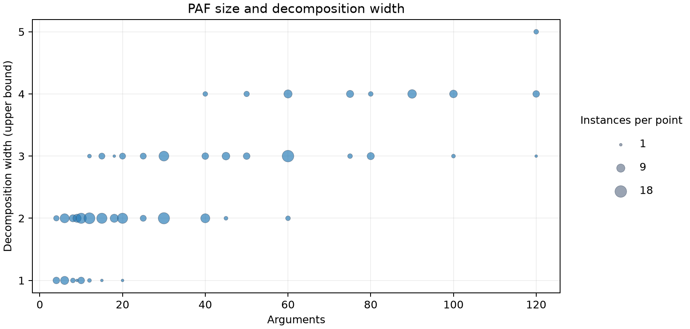

# Dataset report

## Generator parameters

| k | n | Replicates | Grid connection probability |
| --- | --- | --- | --- |
| 2, 3, 4, 5, 6 | 2, 3, 5, 10, 15, 20 | 10 | 75% |

Each PAF has `k × n` arguments; replicates are instances per `(k, n)` pair.
A grid connection means at least one attack between neighbouring vertices.

## Dataset summary

| Instances | Arguments | Attacks | Candidate size | Width upper bound |
| --- | --- | --- | --- | --- |
| 300 | 4–120 | 3–236 | 0–8 | 1–5 |

Attacks are directed. Widths are validated upper bounds on treewidth of the undirected attack graph.

All 300 instances analysed successfully.

Empty candidate sets: 114/300 (38%).

Circle area represents the number of instances at each size and width.

Details: [generator settings](../../families_parameters.tsv) · [measurements](analysis_instances.tsv) · [analysis settings](analysis_settings.json).
